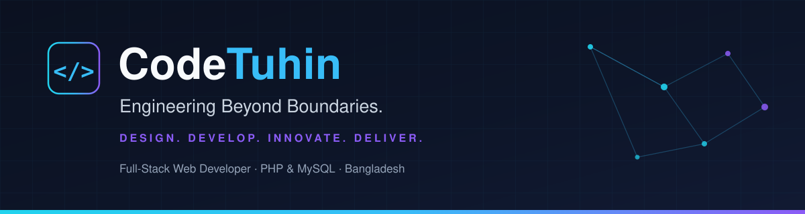

## About Me

I'm **Tuhin**, a web developer from **Bangladesh** and the founder of **CodeTuhin**.
I build professional, fast and secure websites and web systems for businesses — from the
first demo to a finished product with a full admin panel.

My day-to-day work is full-stack: designing the interface, engineering the PHP/MySQL
backend, wiring up REST APIs, and integrating local payment gateways (bKash / Nagad)
so a business can actually sell online. I work mobile-first — much of my development
happens from a phone with Termux and cPanel — and I care about clean architecture,
honest delivery and systems that keep working after handover.

- 🔭 Currently building: **[CodeTuhin Store](https://codetuhin.store)** — my own store & service platform
- 🛡️ I also run **SecureTuhin**, publishing defensive security alerts and awareness posts
- 🌱 Currently learning: **AI systems** and **blockchain / distributed systems** (see *Exploring* below)
- 💬 Ask me about: PHP, MySQL, admin panels, payment integration, website security

## Services

- Business Websites
- E-commerce / Online Shops
- Admin Panels & Management Systems
- bKash / Nagad Payment Integration
- API Integration
- Security & Maintenance

**How it works:** Demo first → order → fast delivery with admin panel.
Selected work is delivered privately to clients; live demos available on request.

## Tech Stack

**Frontend**

**Backend**

**Database & Tools**

## Exploring & Currently Learning

These are active learning interests — **not** services I sell yet:

- **AI & Intelligent Systems** — how AI can be applied inside real products and workflows
- **Blockchain & Web3** — distributed systems, digital identity and transparency-first record keeping

## Featured Projects

### 🛒 CodeTuhin Store — Live Platform

My own store and service platform: ready-made websites, source code, courses and
services, with ordering, an admin panel and local payment integration.

- **Live:** [codetuhin.store](https://codetuhin.store)
- **Stack:** PHP · MySQL · JavaScript
- **Includes:** product catalogue & ordering flow, admin panel, bKash / Nagad payment
  integration via licensed gateways, bilingual (English / বাংলা) interface
- *Source code is private — it is a commercial product sold through the store.*

### 🛡️ security-alerts

Defensive security alerts and awareness write-ups, published under SecureTuhin / CodeTuhin.

## Engineering Principles

- **Security by default** — never an afterthought, never a marketing line
- **Honest scope** — promise only what can be delivered, then deliver it
- **Clean, maintainable code** — the next developer (often me) should thank me
- **Real-world value first** — technology judged by the problem it solves, not the trend

## GitHub Stats

### Contribution Snake

<picture>
  <source media="(prefers-color-scheme: dark)" srcset="https://raw.githubusercontent.com/codetuhinbd/codetuhinbd/output/github-contribution-grid-snake-dark.svg"/>
  <source media="(prefers-color-scheme: light)" srcset="https://raw.githubusercontent.com/codetuhinbd/codetuhinbd/output/github-contribution-grid-snake.svg"/>
  
</picture>

The snake is generated by the <code>snake.yml</code> GitHub Action in this repo (output branch). If it doesn't appear yet, run the workflow once from the Actions tab.

## Connect

- 🌐 Website — [codetuhin.store](https://codetuhin.store)
- 📘 Facebook — [CodeTuhin Page](https://www.facebook.com/profile.php?id=61596472899849)
- 📸 Instagram — [@codetuhin](https://www.instagram.com/codetuhin/)
- 🧵 Threads — [@codetuhin](https://www.threads.com/@codetuhin)
- 🎥 YouTube — [@codetuhin](https://www.youtube.com/@codetuhin)
- ✈️ Telegram — [t.me/codetuhin_channel](https://t.me/codetuhin_channel)
- 💬 WhatsApp — [Chat](https://wa.me/message/JWZOHBYHOWJMA1)

**Design. Develop. Innovate. Deliver.**

